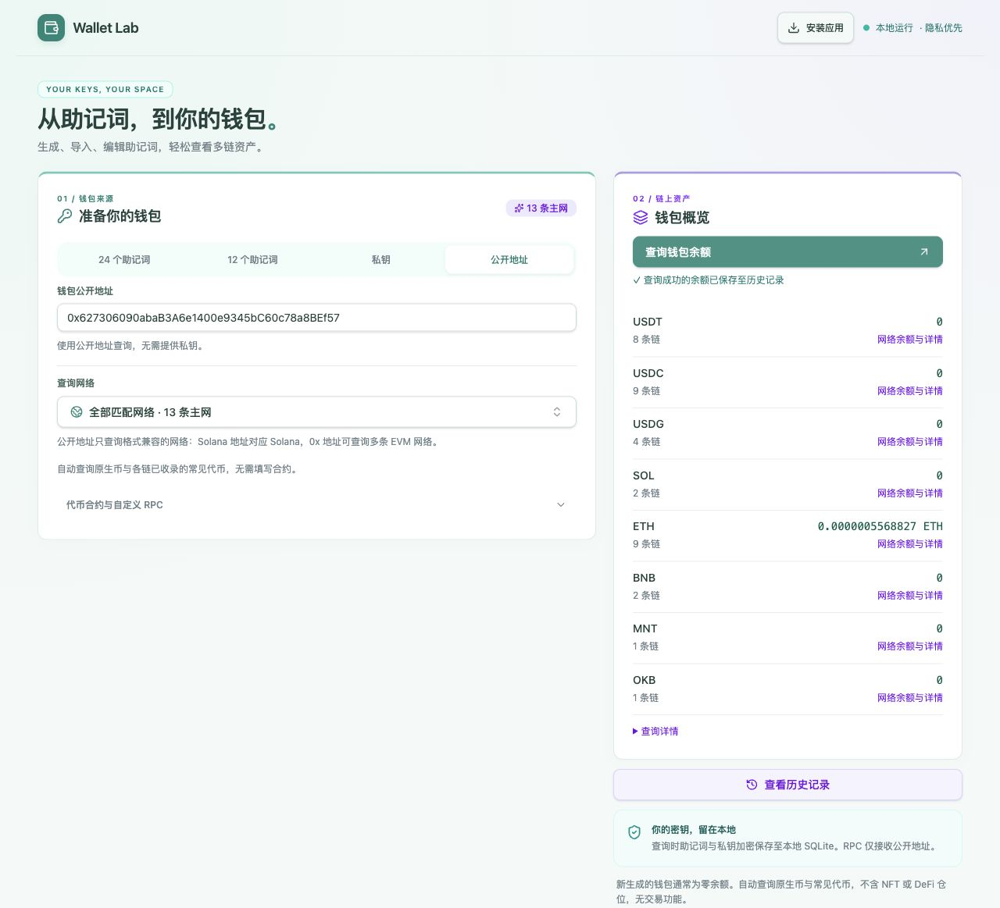
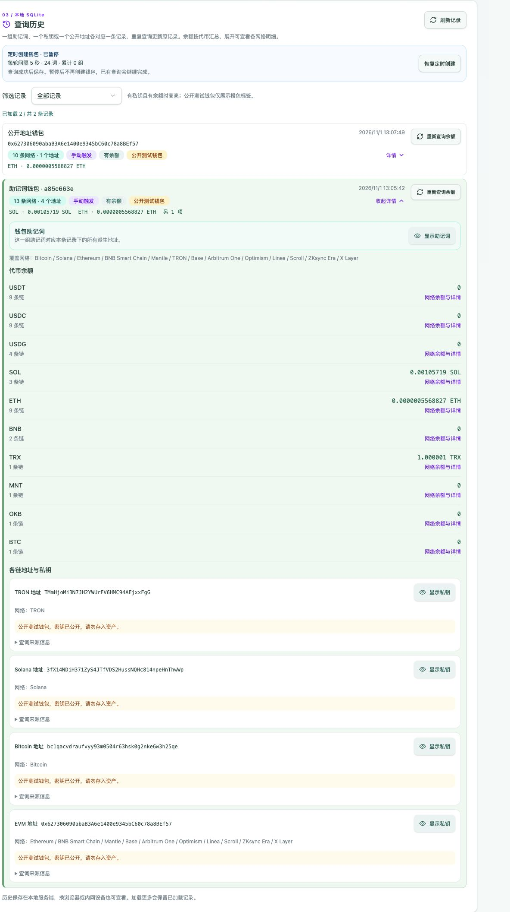
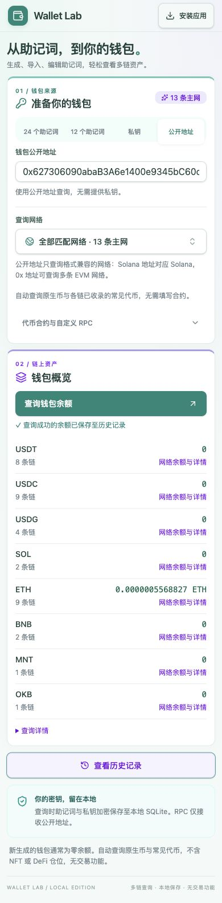

# Wallet Balance

本地运行的多链钱包余额工具。输入公开地址、私钥或 12/24 词助记词，查询原生币与常见代币，并保存查询历史。

[快速开始](#快速开始) · [使用指南](docs/usage.md) · [部署与备份](docs/operations.md) · [开发贡献](#开发与贡献) · [Releases](https://github.com/jearton/wallet-balance/releases)



## 功能

- **多链余额**：支持 13 条主网，按币种汇总，展开查看各网络结果。
- **三种输入**：公开地址、私钥、BIP-39 英文助记词，支持助记词校验与前缀补全。
- **查询历史**：同一输入只保存一条记录，重复查询更新结果，多链地址归入同一个钱包。
- **本地存储**：SQLite 保存历史，助记词与私钥通过 AES-256-GCM 加密，按需显示。
- **后台查询**：定时创建并查询钱包，自动补查未完成的历史，支持暂停与恢复创建。
- **多端使用**：自适应网页、PWA 安装入口与命令行查询。

## 快速开始

需要 **Docker 和 Docker Compose**，以及能访问 GHCR 与公共 RPC 的网络。Linux、macOS 或 Windows 上能够运行 Linux 容器的 Docker 环境均可使用；无需下载源码或安装 Node.js。

发布镜像同时提供 `linux/amd64` 和 `linux/arm64`，Docker 自动选择架构。Intel/AMD 机器及 Apple Silicon Mac 均可使用，无需跨架构模拟。

```bash
mkdir wallet-balance && cd wallet-balance
curl -fsSL https://raw.githubusercontent.com/jearton/wallet-balance/v1.0.1/compose.production.yaml -o compose.yaml
docker compose up -d
```

打开 **<http://127.0.0.1:4173>**。默认绑定宿主机本地地址，首次启动不启用定时创建；历史与加密密钥保存在 Docker 命名卷中。

> 服务没有账号认证，能访问服务的人可以查看历史和已保存的密钥。请仅在本机或可信内网使用，不要直接暴露到公网。仅查余额时优先使用公开地址。

```bash
docker compose logs --tail=50  # 查看日志
docker compose down           # 停止并移除容器，保留数据卷
```

`docker compose down -v` 会删除数据。局域网访问、HTTPS、升级与备份见[部署说明](docs/operations.md)。镜像发布到 [GHCR](https://github.com/jearton/wallet-balance/pkgs/container/wallet-balance)，支持 `linux/amd64` 和 `linux/arm64`；macOS 源码开发见[贡献指南](CONTRIBUTING.md#开发与验证)。

## 使用方式

### 网页

1. 选择公开地址、私钥或助记词，输入钱包信息。
2. 点击查询；结果按代币汇总，可展开查看各链余额。
3. 至少一个网络查询成功后保存历史；重复输入更新原记录，可在详情中重新查询。

一组助记词、一个私钥或一个公开地址各为唯一记录。助记词默认派生第一个地址；公开地址匹配兼容网络。助记词和其派生私钥属于不同输入。失败结果跳过，成功返回的零余额正常保存。



<details>
<summary>查看手机界面</summary>



</details>

截图来自独立演示实例，仅使用公开教学钱包；余额为截图时的结果，未展示助记词或私钥。输入格式、历史重查、定时任务与 PWA 安装见[使用指南](docs/usage.md)。

### 命令行

镜像也包含 CLI，无需启动网页服务：

```bash
# 公开开发账户，只读查询 Ethereum
docker run --rm --entrypoint node ghcr.io/jearton/wallet-balance:1.0.1 \
  dist/cli/index.js --chain ethereum --address 0x627306090abaB3A6e1400e9345bC60c78a8BEf57

# 交互式隐藏输入私钥
docker run --rm -it --entrypoint node ghcr.io/jearton/wallet-balance:1.0.1 \
  dist/cli/index.js --chain ethereum

# 查看全部参数
docker run --rm --entrypoint node ghcr.io/jearton/wallet-balance:1.0.1 \
  dist/cli/index.js --help
```

CLI 不保存密钥或历史，默认查询原生币；指定 ERC-20 合约时使用 `--chain` 和 `--token`。助记词输入与常见代币自动查询在网页提供。

## 支持的网络

| 地址体系 | 主网                                                              | 原生币 |
| -------- | ----------------------------------------------------------------- | ------ |
| EVM      | Ethereum、Base、Arbitrum One、Optimism、Linea、Scroll、ZKsync Era | ETH    |
| EVM      | BNB Smart Chain                                                   | BNB    |
| EVM      | Mantle                                                            | MNT    |
| EVM      | X Layer                                                           | OKB    |
| Bitcoin  | Bitcoin                                                           | BTC    |
| Solana   | Solana                                                            | SOL    |
| TRON     | TRON                                                              | TRX    |

自动查询的代币由[显式白名单](src/shared/common-tokens.ts)维护，合约条目附原始来源。未收录的 EVM 代币可手填合约。Polygon、Avalanche 与 WSOL 已停用，旧结果不参与展示或汇总。

## 使用限制与数据安全

- **不等于完整钱包资产**：不扫描 HD 账户、找零地址或其他派生路径；不统计 NFT、DeFi、交易所资产或法币估值。
- **不自动发现所有代币**：仅查询白名单与指定合约。Solana 代币必须完整枚举账户；节点不支持时跳过，不展示部分余额。
- **失败不等于零**：超时、限流或不可查询的网络/代币会跳过；成功返回的零余额正常显示。明确不支持的能力记忆 24 小时。
- **公共节点可能受限**：手动查询还可能受浏览器 CORS 影响；支持的 EVM 网络可指定 HTTPS RPC。
- **PWA 仍需本地服务**：手机完整安装需可信 HTTPS；普通局域网 IP 的 HTTP 访问可能只能添加快捷方式。离线不缓存钱包、历史或余额。

地址推导在本地完成，RPC 仅接收公开地址与只读查询参数，不接收助记词或私钥；程序不签名、不转账。RPC 提供方仍能看到查询地址与来源 IP。

网页会向本地服务提交助记词和私钥以加密保存。加密不能防御同时取得数据库与服务端密钥的访问者。数据位置、访问边界与备份方式见[部署与备份](docs/operations.md#数据与访问边界)。

## 开发与贡献

项目使用 **TypeScript strict、React、Tailwind CSS、Node.js 24 与 SQLite**。浏览器资源打包为静态文件，Node 服务负责历史、加密存储与后台任务；服务端和 CLI 也编译为 JavaScript。

```bash
git clone https://github.com/jearton/wallet-balance.git
cd wallet-balance
```

在 Node.js 24+ 开发环境执行以下命令；macOS 请先用 VS Code 的 **Reopen in Container** 打开项目提供的 `.devcontainer/`。

```bash
npm ci --ignore-scripts
npm run prepare  # 安装 Git hooks
npm run check  # 类型检查、ESLint、Prettier、测试及打包
npm run web    # 启动网页服务
```

源码位于 `src/client/`、`src/server/`、`src/shared/` 与 `src/cli/`。测试位于 `tests/`，维护工具位于 `scripts/`。项目结构、开发监听、独立测试与发布流程见[贡献指南](CONTRIBUTING.md)。应用镜像仅由 Linux CI 构建和发布。

提交使用带 emoji 的 Conventional Commits，可运行 `npm run commit` 交互式生成；Release 更新记录根据提交自动生成。具体规则见[提交规范](CONTRIBUTING.md#提交规范)。

欢迎提交 [Issues](https://github.com/jearton/wallet-balance/issues) 或 Pull Request。问题报告请附复现步骤、运行方式与版本；仅使用公开测试样例，不要提交真实助记词、私钥、数据库或 RPC 凭据。

## 许可证与致谢

本项目采用 [MIT License](LICENSE)。

界面基于 React、Tailwind CSS 与 shadcn/ui（Radix），密码学与地址处理使用 ethers、Noble 和 Scure。shadcn/ui 的 MIT 许可保留在 [SHADCN-LICENSE](docs/licenses/SHADCN-LICENSE)，其他依赖遵循各自许可证。公开演示样例的出处见 [public-community-wallets.ts](src/shared/public-community-wallets.ts)。
